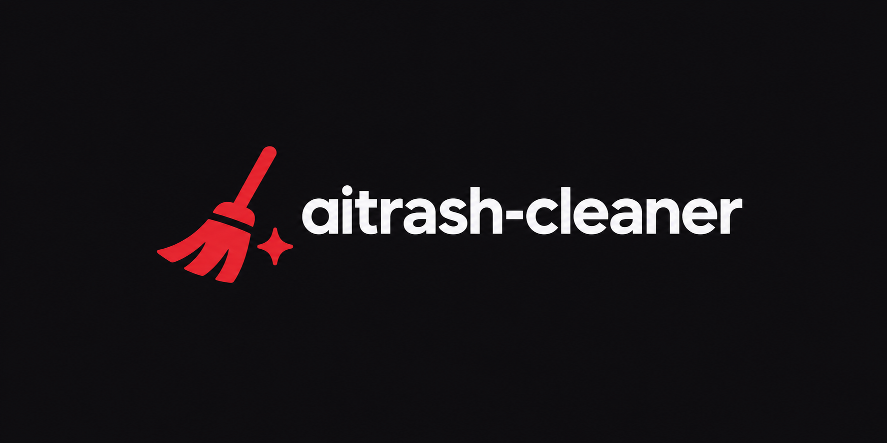

<p align="center"></p>

<h1 align="center">aitrash-cleaner</h1>

Caça o lixo que agentes de IA (Claude Code, Codex, Gemini/Antigravity, Cursor, Windsurf, Kiro) deixam na máquina. É um binário único (cerca de 2 MB), sem runtime, para Linux, macOS e Windows. No WSL ele também varre o perfil do Windows em `/mnt/c/Users`.

## Instalação

**Linux / macOS / WSL:**
```bash
curl -LsSf https://github.com/EduardoRocha234/aitrash-cleaner/releases/latest/download/aitrash-installer.sh | sh
```

**Windows (PowerShell):**
```powershell
irm https://github.com/EduardoRocha234/aitrash-cleaner/releases/latest/download/aitrash-installer.ps1 | iex
```

O instalador detecta o sistema e a arquitetura, baixa o binário certo para `~/.local/bin` e coloca essa pasta no PATH. Abra um novo terminal depois e rode `aitrash`.

**Via npm (quem já tem Node):**
```bash
npx aitrash            # roda sem instalar
npm i -g aitrash       # instala o comando aitrash
```

**Manual:** baixe o arquivo do seu sistema em [Releases](https://github.com/EduardoRocha234/aitrash-cleaner/releases/latest), extraia e coloque o `aitrash` em uma pasta do PATH.

**Do código-fonte** (precisa do [Rust](https://rustup.rs)):
```bash
cargo install --git https://github.com/EduardoRocha234/aitrash-cleaner
```

### Atualizar e desinstalar

Para atualizar, rode o mesmo comando de instalação de novo.

```bash
rm ~/.local/bin/aitrash        # instalador de uma linha (Windows: del $HOME\.local\bin\aitrash.exe)
npm rm -g aitrash              # npm
cargo uninstall aitrash        # código-fonte
```

## Uso

```
aitrash                    # resumo: um grupo por linha (não altera nada)
aitrash -v                 # cada item em detalhe
aitrash scan --home        # varre todos os projetos do home
aitrash clean              # menu por grupo; vai para a lixeira
aitrash clean -n           # dry-run
aitrash secrets --all      # chaves/tokens em texto puro nas transcrições
aitrash secrets --clean    # escolhe transcrições com segredos para apagar
aitrash du                 # quanto cada agente e cache ocupa
aitrash paths              # caminhos conhecidos neste sistema
```

Flags úteis: `--only global,project,system,secrets`, `--older-than 30d`, `--json`, `--verbose`, `--no-wsl`, `--hard` (apaga direto, sem lixeira).

## O que procura

| Categoria | Exemplos |
|---|---|
| global | transcrições/sessões antigas (`~/.claude/projects`, `~/.codex/sessions`, `~/.gemini/tmp`), caches de Cursor/Windsurf/Antigravity, credenciais (`auth.json`) |
| project | `*.bak`, `*.orig`, `test_fix*.py`, `debug_*.js`, `check_*.sh`, `scratch/`, `.md` de resumo, `CLAUDE.md`/`AGENTS.md`/`.claude/` |
| system | caches (playwright, npx, npm, pip, uv, pnpm), dev servers órfãos, worktrees/stashes/branches `claude/*`, Docker parado, linhas de agentes no `.bashrc`/`.zshrc` |
| secrets | `sk-ant-`, `sk-`, `ghp_`, `AKIA…`, `xox?-`, `AIza…`, chaves privadas, `*_TOKEN=`/`*_SECRET=` (sempre mascarados) |

## Segurança

- `scan` nunca altera nada. `clean` sem terminal interativo vira dry-run, a não ser que você passe `--yes`.
- Remoção vai para a lixeira do SO. Para apagar de vez, use `--hard`.
- Só os itens de confiança **alta** vêm pré-marcados. Arquivo rastreado pelo git nunca é pré-marcado, e um arquivo de projeto não rastreado sobe um nível de confiança.
- Itens protegidos `[!]` (credenciais, `.claude.json`, rc files, arquivos rastreados) só aparecem com `--hard`, e cada um pede confirmação.
- Não segue symlinks e não remove nada fora do home ou dos caminhos passados.

## Build

```
cargo build --release                                     # ./target/release/aitrash
cargo build --release --target x86_64-unknown-linux-musl  # binário 100% estático
```

## Lançar uma versão

O workflow `.github/workflows/release.yml` é gerado pelo [cargo-dist](https://github.com/axodotdev/cargo-dist) (`dist generate`; não edite à mão). Para lançar:

1. Suba `version` no `Cargo.toml`.
2. Rode `git commit -am "release: v0.2.0" && git tag v0.2.0 && git push --follow-tags`.

O CI compila para Linux (x86_64/arm64, estático), macOS (Intel/Apple Silicon) e Windows. Depois publica os binários, os instaladores e os checksums no GitHub Releases, e o pacote `aitrash` no npm. Para o npm, crie o secret `NPM_TOKEN` no repositório antes.
